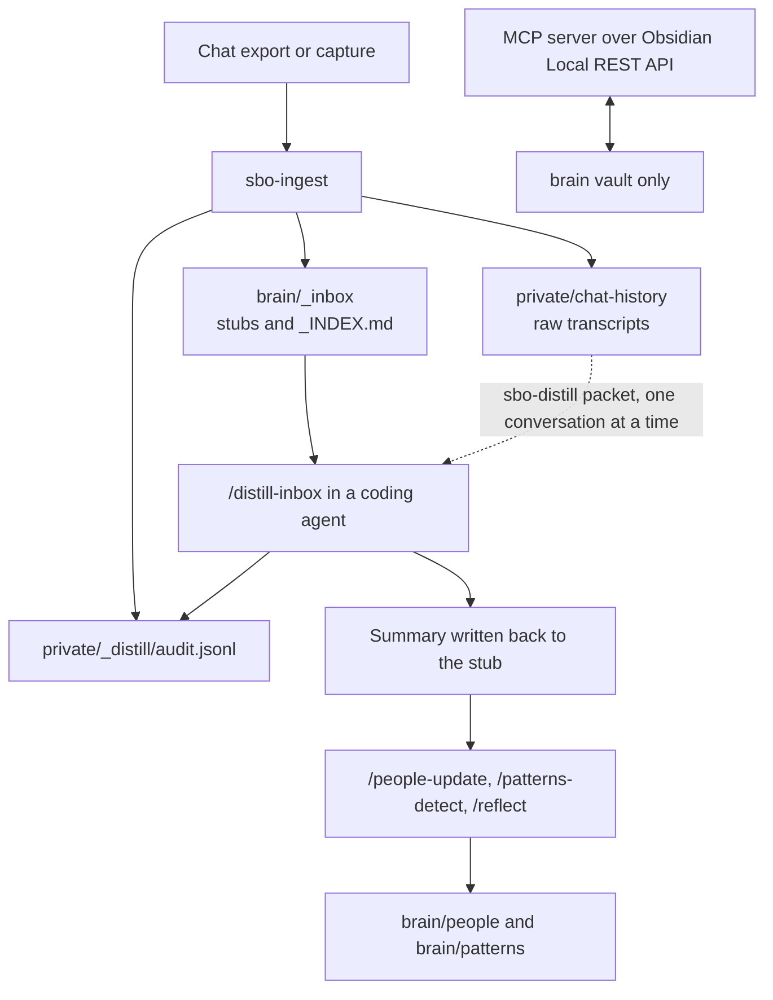

# Second Brain OS

Second Brain OS (SBO) is a template for a two-vault Obsidian setup: a Python CLI imports your Claude.ai and ChatGPT exports, keeps the raw conversations in a private vault, and puts summary stubs in a second vault that your coding agent can read and distill into notes.

[](https://github.com/frankxai/second-brain-os/actions/workflows/test.yml)

Package version 0.3.1 (`pyproject.toml`). MIT licensed. Python 3.11 or newer.

## Who it is for

- You keep notes in Obsidian, or are willing to.
- You have a history of AI conversations you want to search and reuse, and you can request an export from Claude.ai or ChatGPT.
- You already work in a coding agent such as Claude Code, and you are comfortable running a few terminal commands.
- You want raw chat history kept apart from the notes an LLM can browse.

SBO is a template. You clone it, run a setup script that copies two vault skeletons to your disk, and own the result from there. `CONTRIBUTING.md` puts the aim as staying "small, opinionated, and honest about its limits". There is no hosted service, no account, and no plugin API to build against.

## What it does

The code lives in one Python package, `sbo_ingestion`, plus a set of agent commands written as markdown.

**Import.** `sbo-ingest` parses an export and writes two files per conversation:

- the transcript to `private/chat-history/{platform}/`. For a ChatGPT export with edited prompts or regenerated answers, this file holds only the selected branch (or a branch-selection warning when no `current_node` is set); the complete message graph is kept separately under `private/_distill/chatgpt/sources/`, which `/distill-inbox` does not read
- a stub with `status: needs-summary` to `brain/_inbox/{platform}/`

It also regenerates `brain/_inbox/{platform}/_INDEX.md`, appends a line per conversation to `private/_distill/audit.jsonl`, and writes an import receipt under `private/_distill/imports/`.

| Input | Handler |
|---|---|
| Claude.ai `conversations.json` or `.jsonl` | `handlers/claude_ai.py` |
| Claude.ai `memories.json`, as a companion file only: picked up automatically when it sits next to `conversations.json`, or passed with `--memories`. It cannot be the positional input | `handlers/memories.py` |
| ChatGPT `conversations.json`, numbered shards, or the export ZIP as downloaded | `handlers/chatgpt.py` |
| Kura browser captures (`conversation.md`) | `handlers/kura.py` |
| Single idea-capture JSON packets | `handlers/idea_capture.py` |

Re-running an import refreshes the private copy and keeps an existing brain note for the same conversation, including one you have already moved out of `_inbox/`. ZIP layouts that are ambiguous (mixed legacy and sharded members, duplicate or missing shard numbers, duplicate conversation IDs) stop the import. Values taken from an export are sanitised before they are used in a path (`safe_path.py`).

**Distill.** The `/distill-inbox` command runs inside your coding agent session. It uses the `sbo-distill` CLI to pick a small batch of stubs, read each raw conversation in size-limited packets, write a summary into the stub, and record the read in the audit log. Stubs carry a `trust: untrusted-data` marker and the command tells the agent to treat imported text as data, never as instructions.

**Ingestion modes.** `sbo-ingest --mode` takes one of three values:

| Mode | What happens |
|---|---|
| `agent` (default) | Writes raw files and stubs. No API call. You fill the stubs later with `/distill-inbox`. |
| `api` | Summarises through the Anthropic API during import. Paid, and only selected when you pass `--mode api`. Having `ANTHROPIC_API_KEY` set does not switch it on. |
| `dry-run` | Writes raw files and placeholder stubs that are not queued for distilling. For checking an install. |

**Agent commands.** Five commands ship in `.claude/commands/`. They are prompts that an agent follows, so their output depends on the agent and model you run them with.

| Command | Purpose |
|---|---|
| `/distill-inbox` | Fill inbox stubs with summaries |
| `/people-update` | Refresh `brain/people/` following the `people-map` agent contract |
| `/patterns-detect` | Write a weekly `brain/patterns/` note following the `pattern-detector` contract |
| `/reflect` | Draft questions about the brain vault with cited evidence, then drop any that fail the checks in `/sbo-verify` |
| `/sbo-verify` | Check install health and the privacy scripts |

`docs/cross-ai-portability.md` describes how to run the same prompts from other agents.

**Other modules.** `archive_search.py` builds a lexical search index over the brain vault and never opens the private vault. `native_host.py` is a Chrome native messaging host for Kura captures, with a Windows installer script. `voice_check.py` flags stock AI phrasing in generated summaries.

## Quickstart

These commands were run on Linux with Python 3.11. The trial uses a temporary directory so nothing lands in your home folder until you choose to.

```bash
git clone https://github.com/frankxai/second-brain-os
cd second-brain-os

python3 -m venv .venv
source .venv/bin/activate
pip install -e '.[dev]'

sbo-ingest --help
sbo-distill --help
```

Create a trial pair of vaults and import the sample export from the test fixtures:

```bash
TRIAL="$(mktemp -d)"
bash scripts/setup.sh "$TRIAL/second-brain"

export SBO_BRAIN_VAULT_ROOT="$TRIAL/second-brain/brain"
export SBO_PRIVATE_VAULT_ROOT="$TRIAL/second-brain/private"

sbo-ingest tests/fixtures/claude-ai-export-sample.jsonl
sbo-distill list
```

`setup.sh` copies the two skeletons, runs the privacy check on the new private vault, and prints the next steps for Obsidian and MCP. It refuses to run if the target already holds a `brain/` or `private/` folder. `sbo-ingest` prints the path of every file it wrote, and `sbo-distill list` prints the stubs that are waiting for a summary as JSON.

Run the tests:

```bash
pytest
```

When you are ready for a real install, run `bash scripts/setup.sh` with no argument to create the vaults under `~/second-brain`, point the two environment variables there, and pass your own export to `sbo-ingest`. A ChatGPT export can be passed as the ZIP file without extracting it.

The rest of the setup happens outside the terminal: opening both vaults in Obsidian, installing the community plugins, and connecting an MCP server to the brain vault. Follow [docs/getting-started.md](docs/getting-started.md) and [docs/obsidian-mcp.md](docs/obsidian-mcp.md) for those steps. Windows users get PowerShell equivalents of the scripts in `scripts/`.

## How it fits together



The vault layout that `setup.sh` creates:

```
second-brain/
├── brain/
│   ├── _capture.md
│   ├── _inbox/{claude-ai,chatgpt,manual}/
│   ├── notes/{ideas,learnings,decisions}/
│   ├── projects/
│   ├── people/
│   ├── patterns/
│   ├── _meta/
│   ├── _moc/
│   ├── _agents/
│   └── _archive/
└── private/
    ├── chat-history/{claude-ai,chatgpt}/
    ├── journal/
    ├── relationships/
    ├── health/
    ├── finances/
    └── _distill/pending/
```

[docs/architecture.md](docs/architecture.md) explains which folders are written by you, by the ingestion script, and by agents.

## Privacy model

There are two vaults. The **brain vault** is the one you connect to an MCP server, so an LLM can read and write it. The **private vault** holds raw conversations and anything sensitive, and no MCP server is pointed at it.

MCP is never pointed at `private/`. That is a path convention. Nothing in the kernel enforces it: there is no separate uid, container, or mount namespace, and a coding agent with shell access can read either tree.

What the split is meant to prevent: an MCP tool or plugin reaching private content, a retrieval tool pointed at the wrong root, and publishing the brain vault with raw history inside it.

What it leaves open:

- `/distill-inbox` reads the private vault on purpose, one conversation at a time, through the path each stub names. You consent to that when you invoke it, and each completed read is recorded in `private/_distill/audit.jsonl`.
- A Claude `memories.json` companion is copied into `brain/_inbox/{platform}/_memory-export.md` during an ordinary import, with no distillation or consent step.
- When an export carries its own per-conversation summary, that summary is copied into the stub frontmatter and `_INDEX.md`. `SBO_TITLE_POLICY=redacted` does not change either of these two copies.
- Conversation titles are copied into the brain vault by default, as stub headings and as rows in `_INDEX.md`. Set `SBO_TITLE_POLICY=redacted` before importing to use an opaque token there instead; the real title stays in the private copy.
- OS search indexing, cloud sync, system backups, Obsidian Sync, LLM plugins installed in the private vault, and clipboard history are outside what the code controls.

`scripts/verify-privacy.sh` checks the parts a script can check and prints a warning with the manual step for the parts it cannot:

```bash
bash scripts/verify-privacy.sh "$SBO_PRIVATE_VAULT_ROOT"
```

Read [docs/privacy-model.md](docs/privacy-model.md) for the threat model and the hardening checklist before you import anything sensitive.

## Configuration

The CLIs read these from the process environment. `.env.example` lists the names; nothing in the package loads a `.env` file for you.

| Variable | Used by |
|---|---|
| `SBO_BRAIN_VAULT_ROOT` | Default for `--brain-root` |
| `SBO_PRIVATE_VAULT_ROOT` | Default for `--private-root` |
| `ANTHROPIC_API_KEY` | `sbo-ingest --mode api` only |
| `SBO_TITLE_POLICY` | Title handling in stubs and indexes (`redacted` hides titles) |
| `SBO_VERIFY_MODE` | `scripts/verify-privacy.*` check set (`strict` or `template`) |
| `SBO_BANNED_PHRASES_FILE` | Custom phrase list for `voice_check.py` |
| `SBO_SIS_ROOT`, `SIS_ROOT` | Optional Starlight Intelligence System location for `continuity.py` |
| `OBSIDIAN_API_KEY`, `OBSIDIAN_HOST`, `OBSIDIAN_PORT` | The Obsidian MCP server, see [docs/obsidian-mcp.md](docs/obsidian-mcp.md) |

## Project layout

```
src/sbo_ingestion/      Python package: ingest and distill CLIs, handlers, audit log
tests/                  pytest suite and export fixtures
scripts/                setup and verify-privacy (bash and PowerShell), Kura helpers
templates/              brain-vault-skeleton and private-vault-skeleton
.claude/commands/       the five agent commands
docs/                   guides listed below
mcp.json                MCP dependency and vault-root declaration
AGENTS.md, SKILL.md, CANON.md   agent contracts and SIP manifests
```

## Documentation

| Doc | Covers |
|---|---|
| [Getting started](docs/getting-started.md) | Full walkthrough including Obsidian and MCP |
| [Ingestion guide](docs/ingestion-guide.md) | Requesting exports and running `sbo-ingest` |
| [Capture and automation](docs/automation.md) | Kura captures, repeat processing, recovery |
| [Native intake](docs/native-intake.md) | Chrome native host and packet-based distilling |
| [Idea capture](docs/idea-capture.md) | The idea-capture packet format |
| [Archive search](docs/archive-search.md) | Cited search over the brain vault |
| [Obsidian MCP setup](docs/obsidian-mcp.md) | Connecting Claude Code or Claude Desktop to the brain vault |
| [Privacy model](docs/privacy-model.md) | Threat model and hardening checklist |
| [Architecture](docs/architecture.md) | Edges, vaults, folder ownership |
| [Reflection engine](docs/reflection-engine.md) | The pipeline behind `/reflect` and its verify checks |
| [Cross-AI portability](docs/cross-ai-portability.md) | Running the commands from other agents |
| [Continuity](docs/continuity.md) | Session continuity and recovery |
| [Composition guide](docs/composition-guide.md) | Optional wiring to other Starlight components |
| [Swarm curation](docs/swarm-curation.md) | Optional multi-model curation pattern |
| [MCP usage policy](docs/mcp-usage-policy.md) | Rules for MCP use in this project |
| [Paid tier](docs/paid-tier.md) | What the planned paid package adds |
| [Changelog](CHANGELOG.md) | Release history |

## Open source and paid tier

Everything in this repository is free and MIT licensed: the two vault skeletons, the ingestion pipeline, the two starter agents (`people-map` and `pattern-detector`), the privacy scripts, the setup scripts, and the docs. `docs/paid-tier.md` calls this "a complete substrate" that you can use indefinitely without paying.

The same page describes a planned paid package, `@frankx/second-brain-pro`, which would add eight further agents and live in a separate repository. Its status there is "not yet shipped". [docs/paid-tier.md](docs/paid-tier.md) is the source of truth for that boundary.

## Contributing

Read [CONTRIBUTING.md](CONTRIBUTING.md) first. The short version:

- `pytest` must pass. CI runs it on Ubuntu, macOS and Windows with Python 3.11, 3.12 and 3.13.
- If you touch `scripts/`, `templates/`, or `src/sbo_ingestion/dual_write.py`, also run `bash scripts/verify-privacy.sh templates/private-vault-skeleton`.
- Changes that give MCP a path into `private/`, or that add a mandatory cloud dependency, are not accepted.

The project follows the [Contributor Covenant](CODE_OF_CONDUCT.md).

## License

MIT. Copyright (c) 2026 Frank Riemer. See [LICENSE](LICENSE).

SBO is built on the Starlight Intelligence Protocol (SIP) v1.1.1. See [Starlight-Intelligence-System](https://github.com/frankxai/Starlight-Intelligence-System).
